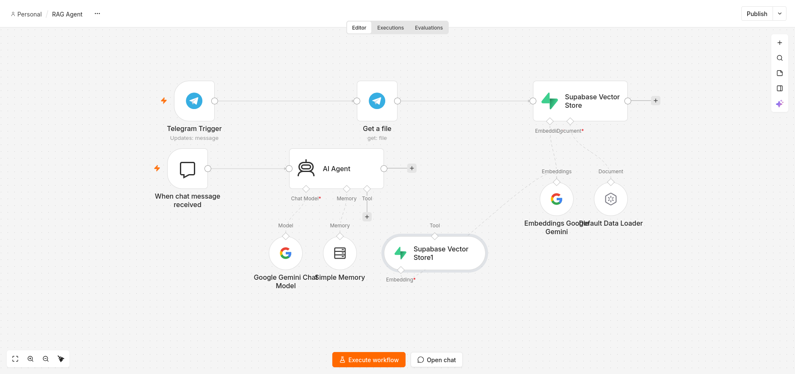
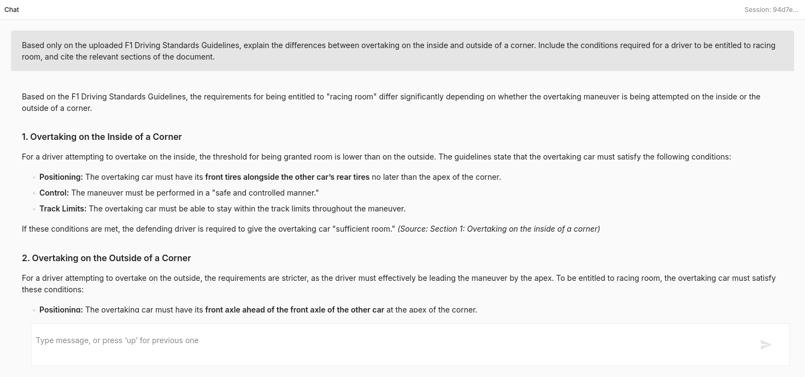
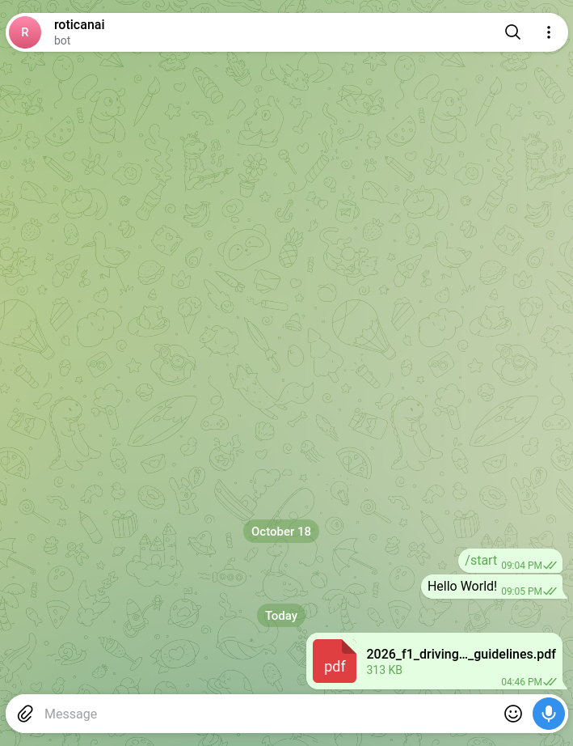

# n8n-rag-agent
An automated document question-answering system built using n8n, Telegram, Google Gemini, and Supabase. The project implements Retrieval-Augmented Generation (RAG) to allow users to upload PDF documents and interact with their contents through a Telegram bot.






## 🚀Installation
```bash
git clone https://github.com/jjohntan/n8n-rag-agent
cd n8n-rag-agent
```
### Create a Quick Tunnel
start a Quick Tunnel:
```bash
cloudflared tunnel --url http://localhost:5678
```
### Environment setup
```bash
TMP_URL=your_quick_tunnel
```
### Start n8n using Docker
```bash
docker compose up -d
```
Access n8n at:
Open the trycloudflare.com URL printed by cloudflared

# Reference
https://developers.cloudflare.com/tunnel/get-started/quick-tunnels/?utm_source=chatgpt.com

https://www.hostinger.com/my/tutorials/n8n-telegram-integration/
https://youtu.be/cCD303XsUjI?si=bmMg5E08skFs55xS